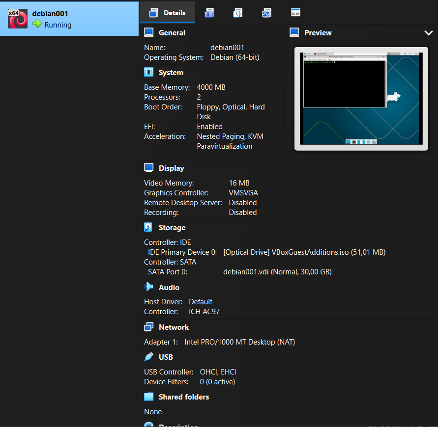

# H1 Hei Ansiblen maailma

## Artikkeli SSH Public key - Login without password

- SSH on käytetyin ja turvallinen tapa kirjautua etänä palvelimelle
- SSH pääsyavaimet: private ja public key
- Ei salasanakirjautumista (turvallisempaa)
- SSH on daemon
- Moni palvelu käyttää SSH:ta, muun muassa Ansible
- ```ssh-keygen``` -komennolla luodaan avainpari
- Public key kopioidaan hostille mihin haluat kirjautua, esimerkiksi ```ssh-copy-id localhost```

## Artikkeli: Hello Ansible

- Ansible on konfiguraation hallintatyökalu
- Toimii SHH:n kautta
- Lista hosteista jota hallitaan, hosts.ini
- Listaa mitkä ryhmät (joissa hosteja) saavat mitkäkin konfiguraatiot (roolit), Site.yml


## Johdanto

Tämän tehtävän päämääränä on asentaa Linux Debian 13 käyttöjärjestelmä virtuaalikoneeseen, sekä asentaa siihen SSH-daemon. Kun SSH on asennettu automatisoidaan kirjautuminen localhostiin public keyllä. Tehtävässä myös asennetaan Debianille Ansible konfiguraation hallintatyökalu.

### a) Debian 13 asennus virtuaalikoneeseen

Loin tätä kurssia varten jo ennen ensimmäistä luentoa uuden virtuaalikoneen Virtual Boxissa, jolle asensin Linux Debian 13. Käytin hyödyksi Johanna Heinosen Linux-palvelimet-kurssin GitRepoa, joka on listattu lähteissä. Debianin asennus sujui ilman ongelmia, joten jätän tämän osan raportissa suppeaksi.




### b) SSH:n asennus Debianiin ja avaimella kirjautuminen localhostiin

Aloitin tekemään tätä osaa tehtävästä jo luennolla, joten kuvakaappaukset voivat olla vähän, mutta laitetaan sen piikkiin, että tämä on kurssin ensimmäinen raportti.

Asennan SSH:n komennolla

```sudo apt-get install ssh```


Luodaan avainpari ja kopioidaan se ```ssh-copy-id localhost``` -komennolla.


Komennolla ```ssh localhost``` otetaan yhteys ja komennolla ```w``` voidaan todeta että kirjautumisia on kaksi samaan aikaan. Komennolla ```exit``` suljetaan yhteys localhostiin.


## Hello Ansible

Asennetaan Ansible ```sudo apt-get install ansible micro bash-completion tree``` -komennolla ja tehdään Ansible-hakemisto


Tehdään hosts.ini ja lisätään localhost sinne. Komento ansible all -a 'uptime' -i hosts.ini suorittaa uptime-komennon kaikilla hosts.ini-tiedostossa määritellyillä palvelimilla. Ansible käyttää ad hoc -komentoa, jolla voidaan suorittaa yksittäisiä tehtäviä useilla etäpalvelimilla ilman playbookia (Ansible Documentation, 2026).

Lisätään hosts.ini-tiedostoon Python lause, jolla varoitusteksti Python versiosta saadaan poistumaan ja testataan poistuiko se.


Luodaan ansible.cfg -tiedosto. ja määrittämällä siinä asetuksen inventory = hosts.ini. Tällä hosts.ini voidaan asettaa Ansiblen oletukseksi. Tämä tehdään sen vuoksi ettei komennossa ```ansible all -a 'uptime' -i hosts.ini``` tarvitsi käyttää joka kerta hosts.ini. (Karvinen 2026, Hello Ansible). Esimerkiksi komento ansible all -a "uptime" käyttää automaattisesti tiedostoa hosts.ini, suorittaa uptime-komennon kaikilla hosteilla ja palauttaa tulokset käyttäjälle.


### Site.yml

Luodaan tiedosto Site.yml, mikä määrittää hostit ryhmiin ja ryhmä määrittää mitkä konfiguraatiot siihen kuuluva host saa. Annetaan ryhmälle rooli "hello", mutta kuten errorista näkyy, sitä ei ole vielä luotu, eli se ei ole olemassa.


Seuraavaksi käydään luomassa roles -tiedosto.


Ajetaan komento ```ansible-playbook site.yml``` uudestaan. Nyt kun rooli on luotu, ei tule erroria enää.


### Lopputulos

Tässä harjoituksessa luomani hakemistot ja tiedostot.


## Lähteet

Karvinen 2026: Hello Ansible https://terokarvinen.com/hello-ansible/

Karvinen 2026: SSH public key - Login without password https://terokarvinen.com/ssh-public-key-login-without-password/

Heinonen 2026: Linux palvelimet Module 1 https://github.com/johannaheinonen/johanna-test-repo/blob/main/module_1.md

Ansible Documentation 2026: Introduction to Ad Hoc Commands https://docs.ansible.com/ansible/latest/command_guide/intro_adhoc.html

Tätä dokumenttia saa kopioida ja muokata GNU General Public License (versio 2 tai uudempi) mukaisesti. http://www.gnu.org/licenses/gpl.html
