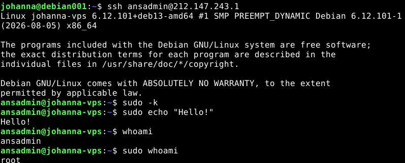
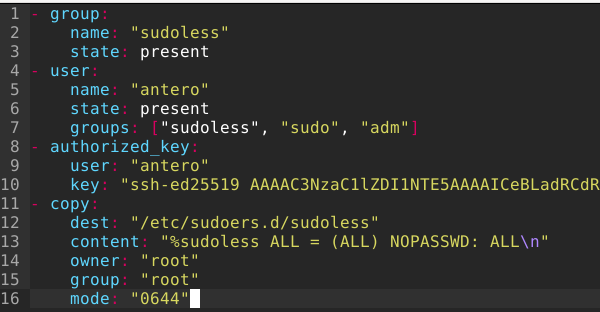
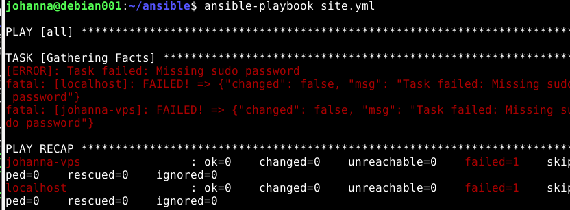
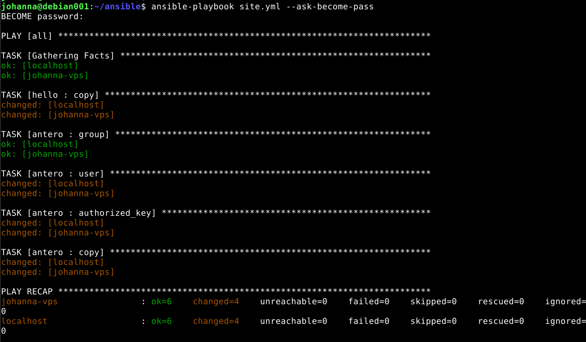
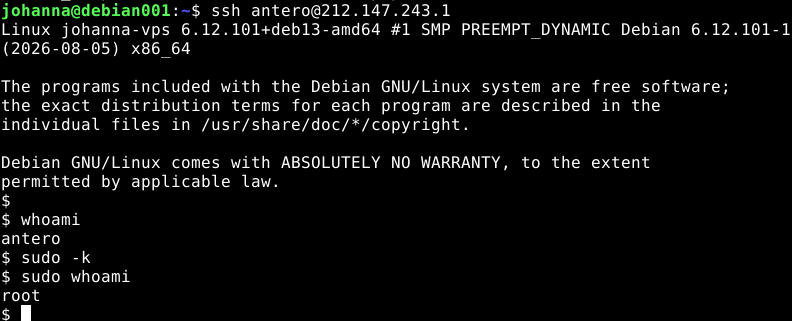
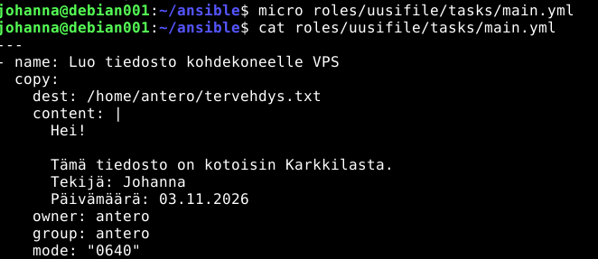
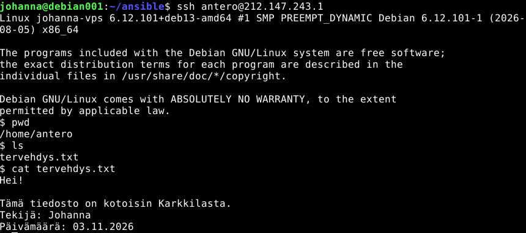
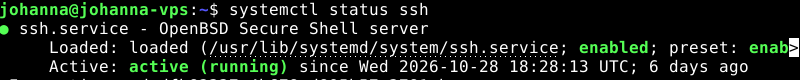

# H2 Voileipä

## Artikkeli: Karvinen, 2026: Sudo without password
- Ansible tarvitsee salasanattoman sudon kohdekoneella esimerkiksi pakettien asentamista varten.
- Käyttäjälle voidaan antaa salasanaton sudo luomalla ryhmä (esim. sudoless) ja lisäämällä käyttäjä siihen.
- Tiedostoon /etc/sudoers.d/sudoless lisätään sääntö
```%sudoless ALL=(ALL) NOPASSWD: ALL ```
- NOPASSWD mahdollistaa sudo-käskyjen suorittamisen ilman salasanan syöttämistä.
- visudo-ohjelmaa kannattaa käyttää sudoers-tiedostojen muokkaamiseen, koska se tarkistaa syntaksin.
- Sudo-muutosten jälkeen käyttäjän tulee kirjautua ulos ja takaisin sisään, jotta ryhmäjäsenyydet päivittyvät.
- Salasanaton sudo helpottaa Ansible-automaatiota, koska sudo ei pysäytä playbookeja salasanakyselyyn.
- Oma huomio: Salasanaton sudo on kätevä, mutta sitä kannattaa antaa vain erikseen luodulle ylläpitokäyttäjälle eikä kaikille käyttäjille.

Lähde: Karvinen, T. 2026. Sudo without password.


## Artikkeli: Munroe, 2006: xkcd 149 - Sandwich
- Sarjakuvassa käyttäjä ei saa tehdä haluamaansa asiaa itse.
- Käyttäjä pyytää saman asian sudona ja saa toisen tekemään voileivän.
- Oma huomio: Sarjakuva liittyy hyvin sudo-aiheeseen, koska tavallinen käyttäjä ei voi tehdä kaikkea itse, vaan tarvitsee aina välillä sudo-oikeuksia.

Lähde: Munroe 2006: xkcd 149: Sandwitch.


## Artikkeli: Karvinen, 2026: Passwordless Sudo with Ansible
- Teron sääntö nro 1 infraa koodina: Manuaalinen ennen automaatiota, eli ensin käsin ja sitten vasta automaationa.
- Salasanaton sudo voidaan automatisoida Ansible-roolilla.
- Rooli luo käyttäjän, ryhmän ja SSH-avainkirjautumisen automaattisesti.
- Sudo annetaan luomalla tiedosto /etc/sudoers.d/sudoless.
- authorized_key-moduulilla voidaan lisätä julkinen SSH-avain käyttäjälle.
- Ensimmäisellä ajokerralla Ansible tarvitsee yleensä salasanan ```--ask-become-password```.
- Oma huomio: Artikkeli havainnollistaa hyvin IaC:n ajatusta. Ensin tehdään asia käsin, sitten sama toteutetaan automaattisesti esim. Ansiblella.

Lähde: Karvinen, T. 2026. Passwordless Sudo with Ansible.


## Artikkeli: Ansible Documentation

**ansible-doc apt**
apt-moduulilla hallitaan Debian-pohjaisten järjestelmien paketteja. Moduulilla voidaan asentaa, poistaa ja päivittää paketteja.
Optiot:
name: paketin nimi.
state: paketin haluttu tila, esim. present tai absent.
update_cache: päivittää pakettivaraston ennen toimenpiteitä.

            - name: Asenna htop
            apt:
                name: htop
                state: present

Lähde: Ansible Community Documentation. 2026. ansible.builtin.apt module Manages apt-packages.


**ansible-doc file**
file-moduulilla hallitaan tiedostojen, hakemistojen ja linkkien ominaisuuksia. Moduulilla voidaan määrittää omistaja, ryhmä ja käyttöoikeudet.
Optiot:
path: tiedoston tai hakemiston polku.
recurse: muokkaa myös alihakemistoja ja tiedostoja.
src: linkin lähdepolku.
state: tiedoston tai hakemiston tila.
owner: omistaja.
group: ryhmä.
mode: käyttöoikeudet.

            - name: Luo hakemisto
            file:
            path: /tmp/testi
            state: directory

Lähde: Ansible Community Documentation. 2026. ansible.builtin.file module Manage files and file properties.


**ansible-doc user**
user-moduulilla hallitaan käyttäjätilejä. Moduulilla voidaan luoda, poistaa ja muokata käyttäjiä.
Optiot:
name: käyttäjän nimi.
create_home: luodaanko kotihakemisto.
comment: käyttäjän kuvaus.
groups: käyttäjän ryhmät.
shell: kirjautumiskuori.
state: käyttäjän tila.
system: määrittää järjestelmäkäyttäjän.

            - name: Luo käyttäjä
            user:
            name: antero
            create_home: true

Lähde: Ansible Community Documentation. 2026. ansible.builtin.user module Manage user accounts.


**ansible-doc authorized_key**
authorized_key-moduulilla hallitaan käyttäjien SSH-julkisia avaimia. Moduuli mahdollistaa salasanattoman SSH-kirjautumisen.
Optiot:
user: käyttäjä, jolle avain lisätään.
key: lisättävä julkinen avain.


Lähde: Ansible Community Documentation. 2026. ansible.builtin.authorized_key module Add or remove an SSH authorized key.


## Johdanto
Oma Debian-virtuaalikoneeni toimii Ansible-ohjauskoneena. UpCloudin VPS toimii kohdekoneena, jolle Ansible suorittaa tehtävät SSH-yhteyden kautta.

### a) Sudoless

Loin käyttäjän "ansadmin", joka on lyhenne Ansible administa.

Luodaan käyttäjä
        sudo adduser ansadmin`

Luodaan ryhmä
        sudo groupadd sudoless

Lisätään käyttäjä ryhmään
        sudo adduser ansadmin sudoless

Lopussa tarkistetaan on käyttäjä ansadmin ryhmässä "sudoless".


Avataan uusi terminaali ja otetaan SSH-yhteys kohdekoneeseen (VPS). Siirrytään root-tasolle ja jätetään terminaali taustalle.


Luotiin komennolla
``sudo visudo /etc/sudoers.d/sudoless``
uusi sudoers-sääntö tiedostoon /etc/sudoers.d/sudoless. Tiedostoon lisättiin sääntö, joka sallii sudoless-ryhmän jäsenille sudon käytön ilman salasanan syöttämistä.


Ongelma, koska unohdin SSH:n automatisoinnin tällä käyttäjällä:
        ssh ansadmin@212.147.243.1
        ansadmin@212.147.243.1: Permission denied (publickey).

Korjataan sen lisäämällä pub.key ansadminille:

        sudo mkdir -p /home/ansadmin/.ssh
        sudo nano /home/ansadmin/.ssh/authorized_keys

Oikeudet:

        sudo chown -R ansadmin:ansadmin /home/ansadmin/.ssh
        sudo chmod 700 /home/ansadmin/.ssh
        sudo chmod 600 /home/ansadmin/.ssh/authorized_keys

Nyt SSH-kirjautumisen pitäisi toimia myös ansadminilla. Kokeillaan uudestaan.



Lähde: Karvinen, T. 2026. Sudo without password


### b) Antero

Tässä tehtävänosassa luodaan Ansiblella käyttäjä antero kohdekoneelle. Käyttäjälle määritetään automaattinen SSH-avainkirjautuminen sekä salasanaton sudo.

Luodaan ansiblen roles hakemistoon uusi rooli.

        ├── ansible.cfg
        ├── hosts.ini
        ├── ping.yml
        ├── roles
        │   ├── antero
        │   │   └── tasks
        │   │       └── main.yml
        │   └── hello
        │       └── tasks
        │           └── main.yml
         ── site.yml

Muokataan tiedostoa main.yml. Käytetään avaimena key.pub SSH-avainta.



Seuraavaksi muokataan site.yml-tiedostoa ja lisätään sinne kohdat become: true ja rooli antero.

        - hosts: all
          become: true
          roles:
            - hello
            - antero

Ensin playbookia ajettaessa tulee virheilmoitus sudo-salasanasta.




Ajetaan komento:

        ansible-playbook site.yml --ask-become-pass

Jonka jälkeen syötetään sudo-salasana ja tämän jälkeen antero-rooli luodaan vps:lle.




Tarkistetaan asia kirjautumalla anterolla kohdekoneelle.

Anteron luominen kohdekoneelle on onnistunut! Eli testasin käyttäjän luomisen onnistumisen kirjautumalla kohdekoneelle käyttäjänä antero.




Lähde: Karvinen, T. 2026. Passwordless Sudo with Ansible


### c) Package
Asennetaan kaksi pakettia Ansiblella. Päätin asentaa Gitin ja Htopin.

Aloitan luomalla roolin "packages" ja sinne main.yml.

        mkdir -p roles/packages/tasks
        touch roles/packages/tasks/main.yml

Seuraavaksi lisää main.yml:iin roolin.

        micro roles/packages/tasks/main.yml 
        cat roles/packages/tasks/main.yml 

        ---
        - name: Asenna git ja htop
          apt:
            name:
              - git
              - htop
            state: present
            update_cache: true

Lisätään rooli site.yml.

        micro site.yml 
        more site.yml 
        - hosts: all
        become: true
        roles:
            - hello
            - antero
            - packages

Ajetaan packages rooli.

        TASK [packages : Asenna git ja htop] *******************************************
        changed: [johanna-vps]
        changed: [localhost]

        PLAY RECAP *********************************************************************
        johanna-vps                : ok=7    changed=1    unreachable=0    failed=0    skipped=0    rescued=0    ignored=0   
        localhost                  : ok=7    changed=1    unreachable=0    failed=0    skipped=0    rescued=0    ignored=0 

Tarkistetaan vielä onko VPS kohdekone asentanut paketit.


Ansible hakemiston rakenne tällä hetkellä:

        .
        ├── ansible.cfg
        ├── hosts.ini
        ├── ping.yml
        ├── roles
        │   ├── antero
        │   │   └── tasks
        │   │       └── main.yml
        │   ├── hello
        │   │   └── tasks
        │   │       └── main.yml
        │   └── packages
        │       └── tasks
        │           └── main.yml
        └── site.yml

Lähde: Ansible Community Documentation. 2026. ansible.builtin.apt module Manages apt-packages.


### d) File

Aion luoda Ansiblen kautta tiedoston kohdekoneelle aikaisemmin luomalleni käyttäjälle antero.

Aloitetaan luomalla hakemisto roles-hakemistoon ja tasks ja main.yml.

Rakenne:

            ├── roles
            │   ├── antero
            │   │   └── tasks
            │   │       └── main.yml
            │   ├── hello
            │   │   └── tasks
            │   │       └── main.yml
            │   ├── packages
            │   │   └── tasks
            │   │       └── main.yml
            │   └── uusifile
            │       └── tasks
            │           └── main.yml
            └── site.yml

Luotu rooli:




Lisätään uusifile-rooli site.yml:

            micro site.yml 
            cat site.yml 
            - hosts: all
            become: true
            roles:
                - hello
                - antero
                - packages
                - uusifile

Ajetaan playbook.

        ansible-playbook site.yml

        TASK [uusifile : Luo tiedosto kohdekoneelle VPS] *******************************
        ok: [johanna-vps]

Käydään tarkistamassa kohdekoneella onko tiedosto luotu sinne.




Lähde: Ansible Community Documentation. 2026. ansible.builtin.copy module Copy files to remote locations.


### e) Jotain muuta
Aion käyttää tässä service-moduulia. Tarkoituksena on tarkistaa onko SSH-palvelu käynnissä ja jos on playbook palauttaa ok. Service-moduulilla hallitaan palveluita kohdekoneella. Moduulilla voidaan esimerkiksi käynnistää, pysäyttää, uudelleenkäynnistää tai ottaa palvelu käyttöön käynnistyksen yhteydessä (Ansible Community Documentation, 2026).

Rooli "palvelu":

        - name: Varmista että SSH-palvelu on käynnissä
        service:
            name: ssh
            state: started
            enabled: true

Rakenne tällä hetkellä:

        ├── roles
        │   ├── antero
        │   │   └── tasks
        │   │       └── main.yml
        │   ├── hello
        │   │   └── tasks
        │   │       └── main.yml
        │   ├── packages
        │   │   └── tasks
        │   │       └── main.yml
        │   ├── palvelu
        │   │   └── tasks
        │   │       └── main.yml
        │   └── uusifile
        │       └── tasks
        │           └── main.yml
        └── site.yml

Lisätään site.yml-tiedostoon rooli "palvelu" ja ajetaan.

Palautti ok eli SSH-palvelu käynnissä.

            TASK [palvelu : Varmista että SSH-palvelu on käynnissä] ******************************
            ok: [johanna-vps]

            PLAY RECAP ***************************************************************************
            johanna-vps                : ok=9    changed=0    unreachable=0    failed=0    skipped=0    rescued=0    ignored=0   

Käydään vielä kohdekoneella. Tämä toisaalta turhaa, koska en saisi SSH-yhteyttä jos SSH-palvelu ei olisi käynnissä.




Lähde: Ansible Community Documentation. 2026. ansible.builtin.service module Manage services.

## Loppuyhteenveto

Tämän harjoituksen aikana ymmärrykseni Ansiblen toiminnasta vahvistui tosi paljon. Käytin tämän raportin tekoon paljon aikaa ja silti osa tiivistelmästä jäi tekemättä. Tästä oppineena seuraavaa raporttia varten aion varata enemmän aikaa kuin kaksi iltaa, sillä opittavaa ja luettavaa on paljon.


## Lähdeluettelo

Ansible Community Documentation. 2026. ansible.builtin.apt module Manages apt-packages. Luettavissa: https://docs.ansible.com/projects/ansible/latest/collections/ansible/builtin/apt_module.html Luettu 03.11.2026

Ansible Community Documentation. 2026. ansible.builtin.authorized_key module Add or remove an SSH authorized key. Luettavissa: https://docs.ansible.com/projects/ansible/latest/collections/ansible/posix/authorized_key_module.html Luettu 03.11.2026

Ansible Community Documentation. 2026. ansible.builtin.copy module Copy files to remote locations. Luettavissa: https://docs.ansible.com/projects/ansible/latest/collections/ansible/builtin/copy_module.html Luettu 03.11.2026

Ansible Community Documentation. 2026. ansible.builtin.file module Manage files and file properties. Luettavissa: https://docs.ansible.com/projects/ansible/latest/collections/ansible/builtin/file_module.html Luettu 03.11.2026

Ansible Community Documentation. 2026. ansible.builtin.service module Manage services. Luettavissa: https://docs.ansible.com/projects/ansible/latest/collections/ansible/builtin/service_module.html Luettu 03.11.2026

Ansible Community Documentation. 2026. ansible.builtin.user module Manage user accounts. Luettavissa: https://docs.ansible.com/projects/ansible/latest/collections/ansible/builtin/user_module.html Luettu 03.11.2026

Karvinen, T. 2026. Passwordless Sudo with Ansible. Luettavissa: https://terokarvinen.com/passwordless-sudo-with-ansible/ Luettu: 02.11.2026

Karvinen, T. 2026. Sudo without password. Luettavissa: https://terokarvinen.com/passwordless-sudo/ Luettu 02.11.2026

Munroe 2006: xkcd 149: Sandwich. Luettavissa: https://xkcd.com/149/ Luettu 02.11.2026

### Tekoälyn käyttö

Hyödynsin Microsoft Copilotia lähteiden etsimisessä. Vastaan itse raportin sisällöstä, tehtävien suorittamisesta, komentojen testaamisesta ja tulosten dokumentoinnista.