<!--
c) Automoottorix. Automatisoi Nginx asennus Ansiblella. Ylläpitäjän osuus Ansiblella riittää, itse HTML-weppisivut voi tehdä käsin.
d) Vapaaehtoinen bonus: Osiris-T. Osiris-T asentaa Wazuhin ja tarvittavat virtuaalikoneet. Voit lähettää vihamielistä verkkoliikennettä (tcpreplay), siepata sen (suricata) ja saat tulokset suoraan dashboardille (wazuh). Enemmän alpha kuin se kreikkalainen kirjain. Mutta Oskari, Nico ja Arttu ilahtuvat, jos kokeilet. Häkämies, Saario, Mukkula 2026: Osiris-T. Häkämies etal 2026: How to Install. -->

# H3 Demoni

## x) Tiivistelmät

### Artikkeli: Apache installed with Ansible (Karvinen, 2026)

- Package-file-service, palvelin ensin asennetaan, sitten sen asetustiedostot kopioidaan ja lopuksi palvelu käynnistetään tai käynnistetään uudelleen muutosten jälkeen (potkaisu, restart apache2)
- Roolin rakenne jakautuu kolmeen osaan: tasks, files ja handlers
- Tasks-hakemisto sisältää varsinaiset Ansible-tehtävät, files-hakemisto palvelimen asetustiedostojen mallikopiot ja handlers-hakemisto palvelun uudelleenkäynnistykseen liittyvät toiminnot
- Kun asetustiedosto muuttuu, Ansible käyttää notify-toimintoa kutsumaan handleria, joka käynnistää Apache2-palvelun uudelleen, jotta muutokset tulevat voimaan
- Oma huomio: Ansible ei käynnistä Apache-palvelua uudelleen jokaisen ajon yhteydessä, vaan vain silloin, kun asetustiedostoihin on tullut muutoksia.

Lähde: Karvinen, T. 2026. Apache installed with Ansible - quick notes

### Artikkeli: Handlers: running operations on change (Ansible Community Documentation, 2026)
- Handlers ovat Ansible-tehtäviä, jotka suoritetaan vain silloin, kun jokin aiempi tehtävä ilmoittaa muutoksesta (notify)
- Yksi käyttötapa on palvelun uudelleenkäynnistäminen asetustiedoston muuttuessa, jolloin palvelua ei käynnistetä turhaan jokaisella Ansible-ajolla
- Yksi tai useampi tehtävä voi ilmoittaa samalle handlerille, mutta handler suoritetaan vain kerran ajokertaa kohden
- Handlerit suoritetaan playbookin lopussa niiden määrittelyjärjestyksessä
- Oma huomio: Handlerit suoritetaan vasta playbookin lopussa eikä heti kun muutokset havaitaan, koska se voisi vaikuttaa siihen missä järjetyksessä palvelimen muutokset tulee voimaan

Lähde: Ansible Community Documentation, 2026. Handlers: running operations on change

### Artikkeli: ansible-doc service (Ansible Community Documentation, 2026)
- service-moduulilla voidaan hallita palveluita eri käyttöjärjestelmien palvelunhallintajärjestelmissä, kuten systemd:ssä
- Dokumentaation esimerkeissä näytetään palvelun käynnistäminen, pysäyttäminen, uudelleenkäynnistäminen, asetusten uudelleenlataus sekä automaattisen käynnistyksen käyttöönotto.
- Parametrit
  
  name: määrittää hallittavan palvelun nimen, esimerkiksi apache2 tai httpd.
    
    enabled: määrittää käynnistyykö palvelu automaattisesti käyttöjärjestelmän käynnistyessä.
    
    state: määrittää palvelun tilan (started, stopped, restarted, reloaded)
        started ja stopped ovat idempotentteja, eli Ansible tekee muutoksen vain tarvittaessa.
        restarted käynnistää palvelun aina uudelleen riippumatta sen nykyisestä tilasta.
- Oma huomio: started vaikuttaa turvallisemmalta vaihtoehdolta kuin restarted, koska se välttää turhat palvelun uudelleenkäynnistykset.

Lähde: Ansible Community Documentation, 2026. ansible.builtin.service module – Manage services

## Johdanto
Tässä tehtävässä tutustutaan palvelinten käyttöönottoon ja hallintaan sekä automatisointiin Ansiblella. Tehtävän alkuosan (a ja b) toteutan paikallisella virtuaalikoneella (localhost), jossa palveluiden asentaminen ja testaus on turvallista ja helppoa. Tehtävän automatisointiosuudessa käytän VPS-palvelinta, jota hallitsen etäyhteydellä Ansiblella. Tavoitteena on harjoitella sekä palvelimen manuaalista ylläpitoa että automaatiota.

### A) Asenna Apache 2 käsin
Tässä tehtävänosassa on käytetty lähteenä kahta nettisivua, jotka on listattu lähteisiin tehtävän lopussa, sekä lähdeluettelossa. En kuitenkaan ajan säästämiseksi eritellyt erikseen kumpaa lähdettä missäkin kohdassa on käytetty.

Aloitin tarkistamalla, että onko localhostille asennettu Apache2. Jos ei ole, niin ok, mutta jos on niin aion poistaa asennuksen.

                dpkg -l | grep apache2

                systemctl status apache2
                Unit apache2.service could not be found.

Apachea ei ollut asennettu localhostille, joten aloitin asennuksen.

Ensin pakettien päivitys komennoilla:
``sudo apt update`` ja 
``sudo apt upgrade``.

Aloitin paketin asennuksen komennolla ``sudo apt install apache2``.

Tarkistetaan Apache versio

            sudo apache2ctl -v
            Server version: Apache/2.4.69 (Debian)
            Server built:   2026-10-01T16:54:08
        
Tarkistin, että Apache käynnistyy automaattisesti hostin käynnistyessä

            sudo systemctl is-enabled apache2
            enabled

Tässä vaiheessa muistin että Caddy on päällä ja kuuntelee porttia 80. Otin Caddyn väliaikaisesti pois päältä ja estin sitä käynnistymästä uudelleen.

            sudo systemctl stop caddy
            sudo systemctl disable caddy
            Removed '/etc/systemd/system/multi-user.target.wants/caddy.service'.

            sudo ss -tulpn | grep ':80'
            curl localhost
            curl: (7) Failed to connect to localhost port 80 after 0 ms: Could not connect to server

            sudo systemctl start apache2
            sudo systemctl status apache2

Nyt porttia 80 kuuntelee Apache2.

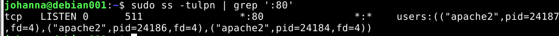

``http://localhost`` selaimeen ja Apchen default page tulee näkyviin.

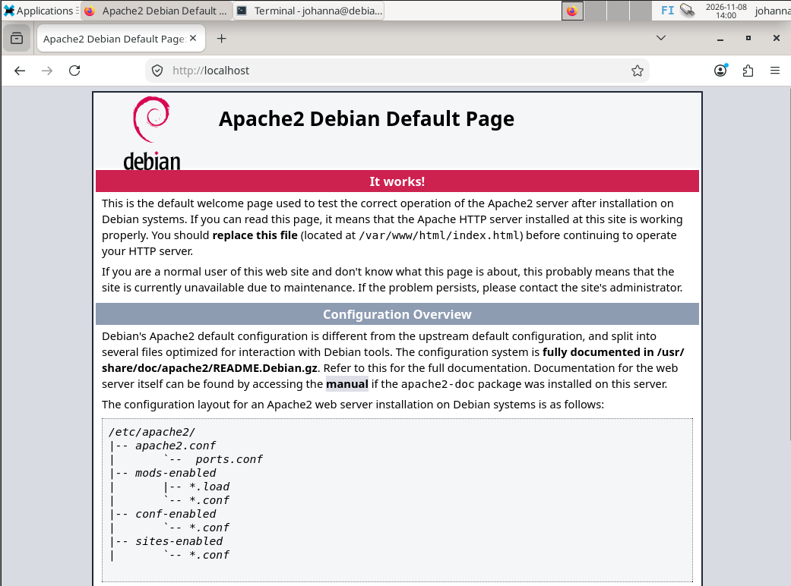

Seuraavaksi haluan, että sivut ovat muokattavissa normaalikäyttäjällä ilman sudoa (tai rootia). On tehtävä VirtualHost, jonka DocumentRoot osoittaa käyttäjän kotihakemistoon.

Ensin loin käyttäjän kotihakemistoon hakemiston, johon konfiguraatiotiedostossa sitten ohjataan (DocumentRoot).

``mkdir -p /home/johanna/testsite``

Tein testsite-hakemistoon index.html-tiedoston.

Loin VirtualHost:n

``sudoedit /etc/apache2/sites-available/testsite.conf``

Konfiguraatiotiedoston sisältö (Lähteenä käytetty: Heinonen, J. 2026. Module 3 Apache 2):

            <VirtualHost *:80>
                ServerName testsite

                DocumentRoot /home/johanna/testsite

                <Directory /home/johanna/testsite>
                    Require all granted
                </Directory>

                ErrorLog ${APACHE_LOG_DIR}/error-testsite.log
                CustomLog ${APACHE_LOG_DIR}/access-testsite.log combined
            </VirtualHost>

Annoin hakemistolle tarvittavat lukuoikeudet, minkä jälkeen verkkosivun sisältöä voi muokata tavallisella käyttäjätunnuksella ilman sudo-oikeuksia.

            chmod 711 /home/johanna
            chmod 755 /home/johanna/testsite
            chmod 644 /home/johanna/testsite/index.html

Otin defaultpagen pois käytöstä ja lisäsin tilalle omani testsite.

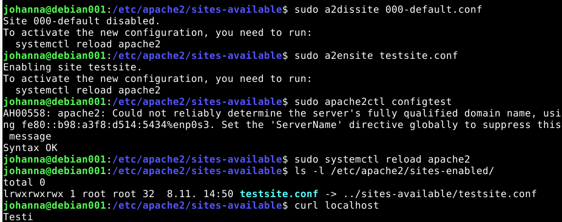

Potkaisin demonia ``sudo systemctl reload apache2``.

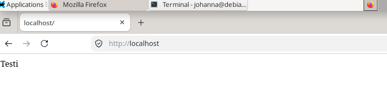

Testasin voiko sivuja oikeasti muoka ilman sudo-oikeuksia. Toimii!

            echo "<h1>Testi toimiiko ilman sudoa</h1>" > ~/testsite/index.html

            curl localhost
            <h1>Testi toimiiko ilman sudoa</h1>
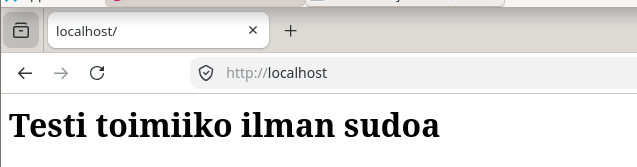

Otin Apachen pois käytöstä seuraavaa tehtävänosaa varten

            sudo systemctl stop apache2

            sudo systemctl disable apache2
            Synchronizing state of apache2.service with SysV service script with /usr/lib/systemd/systemd-sysv-install.
            Executing: /usr/lib/systemd/systemd-sysv-install disable apache2
            Removed '/etc/systemd/system/multi-user.target.wants/apache2.service'.

            sudo systemctl status apache2
            ○ apache2.service - The Apache HTTP Server
                Loaded: loaded (/usr/lib/systemd/system/apache2.service; disabled preset: enabled)
                Active: inactive (dead) since Sun 2026-11-08 15:04:22 EET; 12s ago
            Duration: 1h 14min 44.276s
            Invocation: d7df3581338d43f084f5a0da3c8073d2
                Docs: https://httpd.apache.org/docs/2.4/
            Main PID: 24184 (code=exited, status=0/SUCCESS)
            Mem peak: 7.6M
                    CPU: 609ms

Komennolla ``sudo ss -tulpn | grep ':80'`` tarkistan kuunteleeko Apache vielä porttia 80.

**PALOMUURI**

Asensin UFW:n (uncomplicated firewall).
1. Asennetaan paketti
2. Sallitaan palomuurin säännöissä SSH-yhteys eli portti 22
3. Sallitaan http eli portti 80.
4. Tarkistetaan palomuurin aktiiviset säännöt
5. Laitetaan palomuuri päälle

                sudo apt install ufw
                sudo ufw allow ssh
                sudo ufw allow 80/tcp
                sudo ufw status verbose
                sudo ufw enable

Palomuuri on nyt käynnissä ja säännöt lisätty.

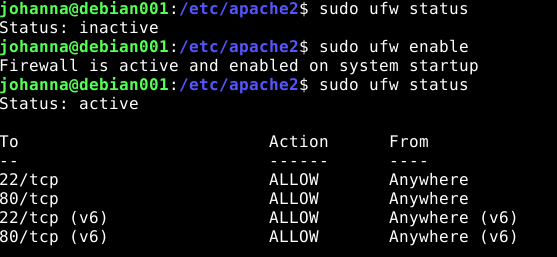

Lähteet:
Heinonen, J. 2026. Module 3 Apache 2

Linux Capable. 2026. How to Install Apache on Debian 13, 12 and 11

### B) Asenna Nginx käsin
Lähteenä käytetty kahta artikkelia jotka lueteltu tämän tehtävänosan lopussa, sekä lähdeluettelossa.

Toistan saman vaiheen kuin Apachen asennuksessa, eli pakettiien päivityksen, sillä näiden tehtävienosien teossa on päivien väli. Pakettien päivitys komennoilla:
``sudo apt update`` ja 
``sudo apt upgrade``.

Kun paketit on päivitetty, aloitin Nginxin asennuksen.

``sudo apt install nginx``

Tarkistin Nginxin toiminnan asennuksen jälkeen, ``sudo systemctl status nginx``.

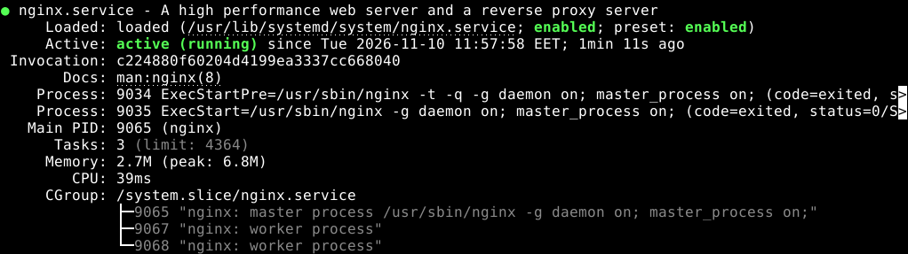

Tässä vaiheessa tein samat asiat, kuin aikaisemmassa tehtävässä, jossa asennetaan Apache ja sivua halutaan muokata ilman sudo-oikeuksia.

Tein käyttäjän kotihakemistoon hakemiston nimeltä "nginxtestsite", johon loin html-tiedoston nimeltä "index.html". Käytin Microsoft Copilotia yksinkertaisen sivun luomiseen.

Hakemistorakenne on yksinkertainen:

            ── nginxtestsite
            │   └── index.html

Annoin tarvittavat suoritusoikeudet komennoilla
``chmod 711 ~``
``chmod 755 ~/nginxtestsite``
``chmod 644 ~/nginxtestsite/index.html``

Tarkistin onko Nginxillä oikeudet suorittaa hakemistoa:

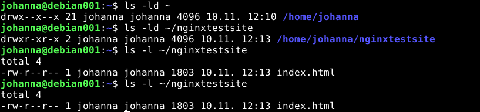

Seuraavaksi loin Nginxille konfiguraatiotiedoston (Linuxize, 2026).
``sudo nano /etc/nginx/sites-available/nginxtestsite``

Vaihdoin rootiksi juuri luomani hakemiston käyttäjän kotihakemistossa.

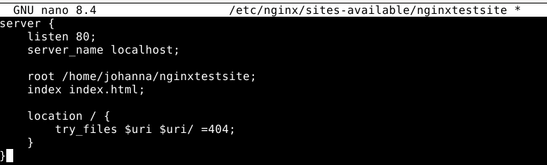

Otin sivun käyttöön ``sudo ln -s /etc/nginx/sites-available/nginxtestsite /etc/nginx/sites-enabled/``

Testasin konfiguraation ennen reloadia ``sudo nginx -t``-komennolla (Linuxize, 2026).

            nginx: the configuration file /etc/nginx/nginx.conf syntax is ok
            nginx: configuration file /etc/nginx/nginx.conf test is successful

Potkaistaan demonia ``sudo systemctl reload nginx``.

Selaimessa näkyi nyt luomani sivu (Sivun luomiseen käytetty Microsoftin Copilot-kielimallia).

Seuraavaksi tarkistin vielä käytännössä että sivun muokkaaminen ilman sudoa on mahdollista.
``nano ~/nginxtestsite/index.html``

Lisäsin html-tiedostoon kaksi sanaa:
Sivusto sijaitsee käyttäjän kotihakemistossa ja sitä voidaan **TODISTETTAVASTI JA IHAN OIKEASTI** muokata ilman sudo- tai root-oikeuksia.

Lähteet:
Medium. May Rain. 2023. Setup Nginx on Debian 12 and Host a Simple Static Website.

Linuxize. 2026. How to Install Nginx on Debian 13.

### C) Automatisoi Nginx asennus Ansiblella

Tässä tehtävässä paikallinen virtuaalikoneeni asensi Ansiblella Nginxin kohdekoneelle, joka on VPS-palvelin.

Aloitin tehtävän luomalla Ansiblen hakemistoon roolin nimeltä "nginx", jonka alle lähdin rakentamaan tarvittavaa rakennetta.

            ├── nginx
            │   ├── files
            │   ├── handlers
            │   └── tasks

Aloitin kopioimalla roolin files-hakemistoon tarvittavat tiedostot, jotka haluan siirtää kohdekoneelle.

Kopioin index.html-tiedoston (verkkosivuni):
``cp ~/nginxtestsite/index.html ~/ansible/roles/nginx/files/``
Sekä luomani konfiguraatiotiedoston (Nginxin server block-konfiguraatio):
``cp /etc/nginx/sites-available/nginxtestsite ~/ansible/roles/nginx/files/``

            ├── nginx
            │   ├── files
            │   │   ├── index.html
            │   │   └── nginxtestsite
            │   ├── handlers
            │   └── tasks

Aloin rakentamaan tasks-hakemiston main.yml-tiedostoa. Lisäsin name-määrittelyn vain osaan tehtävistä parantaakseni playbookin luettavuutta. Yksinkertaisissa tehtävissä jätin sen pois, jotta koodi pysyy tiiviimpänä.

Tasks main.yml rakenne (KORJAUS: lisätty tiedostoon tehtävä, joka asettaa kotihakemiston oikeuksiksi 0711):

         - apt:
             name: nginx
             state: present

         - file:
             path: /home/johanna
             owner: johanna
             group: johanna
             mode: "0711"

         - file:
             path: /home/johanna/nginxtestsite
             state: directory
             owner: johanna
             group: johanna
             mode: "0755"

         - copy:
             src: index.html
             dest: /home/johanna/nginxtestsite/index.html
             owner: johanna
             group: johanna
             mode: "0644"
           notify: restart nginx

         - copy:
             src: nginxtestsite
             dest: /etc/nginx/sites-available/nginxtestsite
             owner: root
             group: root
             mode: "0644"
           notify: restart nginx

         - name: Enable site
           file:
             src: /etc/nginx/sites-available/nginxtestsite
             dest: /etc/nginx/sites-enabled/nginxtestsite
             state: link
           notify: restart nginx

         - name: Remove default site
           file:
             path: /etc/nginx/sites-enabled/default
             state: absent
           notify: restart nginx

         - service:
             name: nginx
             state: started
             enabled: true

Handlers main.yml sisältö (KORJAUS: nimi korjattu vastaamaan tasks main.yml notify-osaa):

         - name: restart nginx 
           systemd:
             name: nginx 
             state: restarted

Kävin vielä muokkaamassa roolin files-hakemistossa olevaa kofiguraatiotiedostoa.

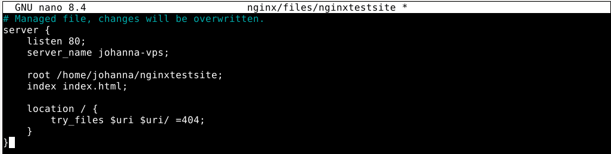

Roolin rakenne:

            ├── nginx
            │   ├── files
            │   │   ├── index.html
            │   │   └── nginxtestsite
            │   ├── handlers
            │   │   └── main.yml
            │   └── tasks
            │       └── main.yml

Lisäsin roolin "nginx" site.yml-tiedostoon. Päätin tässä vaiheeessa, että poistan muut roolit tiedostosta, jotta Ansible ajaa vain nginx-roolin ja oon helpompi korjata ongelmia, mikäli niitä tulee.

         - hosts: all
           become: true
           roles:
             - nginx

Ajan playbookin.

            ansible$ ansible-playbook site.yml

            PLAY [all] *******************************************************************************************

            TASK [Gathering Facts] *******************************************************************************
            ok: [johanna-vps]

            TASK [nginx : apt] ***********************************************************************************
            changed: [johanna-vps]

            TASK [nginx : file] **********************************************************************************
            changed: [johanna-vps]

            TASK [nginx : copy] **********************************************************************************
            [ERROR]: The requested handler 'restart nginx' was not found in either the main handlers list nor in the listening handlers list

Unohdin handlerien kohdalla, että nimien tulee vastata toisiaan exact. Kävin korjaamassa handlers main.yml-tiedostoon nimeksi "restart" sijaan "restart nginx", jotta se täsmää tasks main.yml-tiedostossa olevaa notify-kohtaa.

Eli tätä kohtaa tasks main.yml:

         - name: Enable site
           file:
             src: /etc/nginx/sites-available/nginxtestsite
             dest: /etc/nginx/sites-enabled/nginxtestsite
             state: link
           notify: restart nginx

Ajoin playbookin uudestaan ja tällä kertaa se onnistui ilman erroria.

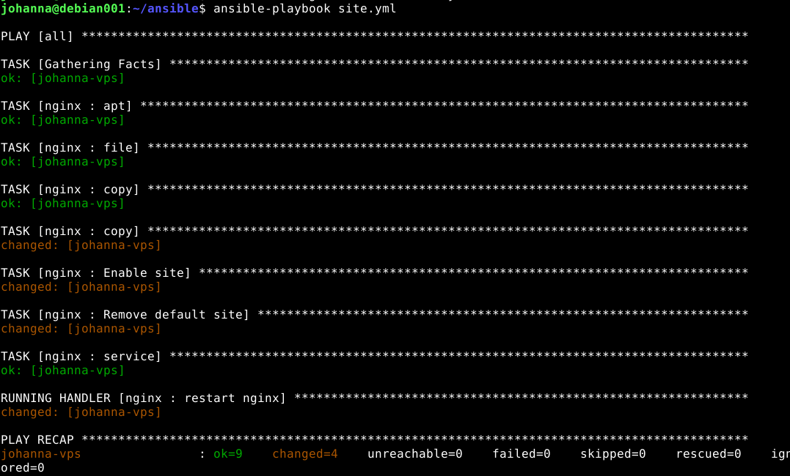

Siirryin VPS:lle katsomaan mitä siellä on tapahtunut.

Jostain syystä Nginx ei ole näytä index.html-tiedoston sisältöä.

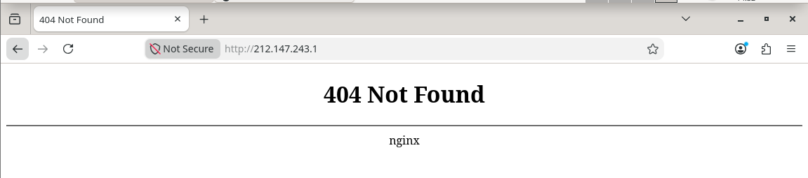

Tutkiessani asiaa, huomasin että kyse oli hakemiston käyttöoikeuksista (yllätys). Päätin, että testaan ensin korjata sen käsin VPS:llä ja sitten korjata playbookin tasks main.yml:n.

VPS:llä:

        ls -ld /home/johanna
        ls -ld /home/johanna/nginxtestsite
        ls -l /home/johanna/nginxtestsite
        drwx------ 6 johanna johanna 4096 Nov 10 12:20 /home/johanna
        drwxr-xr-x 2 johanna johanna 4096 Nov 10 12:20 /home/johanna/nginxtestsite
        total 4
        -rw-r--r-- 1 johanna johanna 1836 Nov 10 12:20 index.html

        chmod 711 /home/johanna

        sudo systemctl restart nginx

Playbookin ajoa ja testausta varten palautin oikeudet niinkuin ne olivat

``chmod 700 /home/johanna``

Ja tarkastan:

            ls -ld /home/johanna
            drwx------ 6 johanna johanna 4096 Nov 10 12:20 /home/johanna

            curl localhost

            <html>
            <head><title>404 Not Found</title></head>
            <body>
            
<h1>404 Not Found</h1>

            

nginx

            </body>
            </html>

Tasks main.yml-tiedostoon lisätään kohta jossa määritellään kotihakemiston käyttöoikeudet

         - apt:
             name: nginx
             state: present

         - file:
             path: /home/johanna
             owner: johanna
             group: johanna
             mode: "0711"

         - file:
             path: /home/johanna/nginxtestsite
             state: directory
             owner: johanna
             group: johanna
             mode: "0755"

         - copy:
             src: index.html
             dest: /home/johanna/nginxtestsite/index.html
             owner: johanna
             group: johanna
             mode: "0644"
           notify: restart nginx

         - copy:
             src: nginxtestsite
             dest: /etc/nginx/sites-available/nginxtestsite
             owner: root
             group: root
             mode: "0644"
           notify: restart nginx

         - name: Enable site
           file:
             src: /etc/nginx/sites-available/nginxtestsite
             dest: /etc/nginx/sites-enabled/nginxtestsite
             state: link
           notify: restart nginx

         - name: Remove default site
           file:
             path: /etc/nginx/sites-enabled/default
             state: absent
           notify: restart nginx

         - service:
             name: nginx
             state: started
             enabled: true

Ajetaan playbook ``ansible-playbook site.yml``.

            PLAY [all] *************************************************************************************************

            TASK [Gathering Facts] *************************************************************************************
            ok: [johanna-vps]

            TASK [nginx : apt] *****************************************************************************************
            ok: [johanna-vps]

            TASK [nginx : file] ****************************************************************************************
            changed: [johanna-vps]

            TASK [nginx : file] ****************************************************************************************
            ok: [johanna-vps]

            TASK [nginx : copy] ****************************************************************************************
            ok: [johanna-vps]

            TASK [nginx : copy] ****************************************************************************************
            ok: [johanna-vps]

            TASK [nginx : Enable site] *********************************************************************************
            ok: [johanna-vps]

            TASK [nginx : Remove default site] *************************************************************************
            ok: [johanna-vps]

            TASK [nginx : service] *************************************************************************************
            ok: [johanna-vps]

            PLAY RECAP *************************************************************************************************
            johanna-vps                : ok=9    changed=1    unreachable=0    failed=0    skipped=0    rescued=0    ignored=0   

Kävin katsomassa VPS:llä toimiiko. Playbook toimi niinkuin kuului.

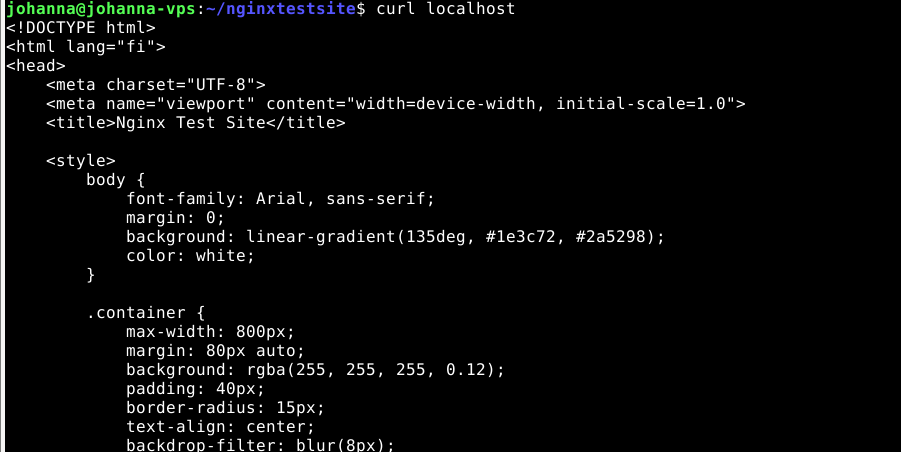

Lähteet:

Linux-server-admin.com. 2026. Setup Nginx with Ansible.

Karvinen, T. 2026. Apache installed with Ansible - quick notes.

AnsibleByExample. 2026. Ansible Nginx — Install, Configure, and Deploy Web Servers.

## Loppuyhteenveto
Raportin teon aikana opin paljon uutta Ansiblen avulla tehtävien automatisoinnista ja sain ratkaista pari ongelmaakin. En tällä kertaa ehtinyt tehdä vapaaehtoista kohtaa d.

## Lähdeluettelo

Ansible Community Documentation, 2026. ansible.builtin.service module – Manage services. Luettavissa: https://docs.ansible.com/projects/ansible/latest/collections/ansible/builtin/service_module.html Luettu 07.11.2026

Ansible Community Documentation, 2026. Handlers: running operations on change. Luettavissa: https://docs.ansible.com/projects/ansible/latest/playbook_guide/playbooks_handlers.html Luettu 07.11.2026

AnsibleByExample. 2026. Ansible Nginx — Install, Configure, and Deploy Web Servers. Luettavissa: https://www.ansiblebyexample.com/articles/ansible-nginx-install-configure-deploy Luettu 10.11.2026

Heinonen, J. 2026. Module 3 Apache 2. Luettavissa: https://github.com/johannaheinonen/johanna-test-repo/blob/17b0979918d58a7ad4e11b0b5aa64e46a3c67fac/module_3.md Luettu 08.11.2026

Karvinen, T. 2026. Apache installed with Ansible - quick notes. Luettavissa: https://terokarvinen.com/apache-ansible/ Luettu 07.11.2026

Linux Capable. 2026. How to Install Apache on Debian 13, 12 and 11. Luettavissa: https://linuxcapable.com/how-to-install-apache-on-debian-linux/ Luettu 08.11.2026

Linux-server-admin.com. 2026. Setup Nginx with Ansible. Luettavissa: https://wiki.linux-server-admin.com/software/webserver/nginx/setup/ansible Luettu 10.11.2026

Linuxize. 2026. How to Install Nginx on Debian 13. Luettavissa: https://linuxize.com/post/how-to-install-nginx-on-debian-13/ Luettu 10.11.2026

Medium. May Rain. 2023. Setup Nginx on Debian 12 and Host a Simple Static Website. Luettavissa: https://medium.com/@mayrain1923/setup-nginx-on-debian-12-and-host-a-simple-static-website-f832e6761e63 Luettu 10.11.2026

## Tekoälyn käyttö
Microsoftin Copilot-kielimallia on käytetty lähteiden etsimiseen, lähdeluettelon aakkostamiseen, sekä Ngixin index.html tiedoston sisällön luomiseen. Vastaan itse raportin sisällöstä, tehtävien suorittamisesta, komentojen testaamisesta ja tulosten dokumentoinnista.