<!--
e) Idempotentti. Osoita, että tilasi on idempotentti.
-->

# H4 Pizza Fantasia

## x) Lue ja tiivistä

### Size and Complexity of Some DSLs
- DSL-kielet (Domain Specific Language) voivat kasvaa erittäin suuriksi ja monimutkaisiksi.
- Saltin DSL sisältää 510 tilafunktiota (state functions), joilla hallitaan kohdekoneiden tilaa.
- Saltin dokumentaatio on yli 20 000 riviä ja yli 75 000 sanaa pitkä, joten sen hallitseminen vaatii paljon opettelua.
- Puppet sisältää 113 funktiota, mutta sen toimintamalli poikkeaa perinteisistä ohjelmointikielistä.
- Puppetissa toistettavia tehtäviä toteutetaan esimerkiksi virtuaaliresursseilla (virtual resource) tavallisten funktioiden sijaan.
- Oma huomio: Konfiguraationhallintatyökalujen tarkoitus on helpottaa ylläpitoa, kuitenkin niiden omien DSL-kielten opettelu voi olla yllättävän vaativaa suuren ominaisuusmäärän takia.

Lähde: Karvinen 2023: Configuration Management of Distributed Systems over Unreliable and Hostile Networks, sivu 112.

### Use of DSL Functions in Case Configuration
- Vaikka CM-työkaluissa on satoja toimintoja, käytännössä vain pieni osa niistä on yleisessä käytössä.
- Pieni määrä toimintoja riittää kattamaan suurimman osan käytännön konfiguraationhallinnan tarpeista.
- Yleisimmät toiminnot liittyvät pakettien asennukseen, asetustiedostojen hallintaan ja palveluiden käynnistämiseen (package, file, service).
- Demonien hallinnassa käytetään usein mallia package-file-service.
- Tarvittaessa voidaan käyttää exec-toimintoa omien komentojen suorittamiseen (tällöin käyttäjän vastuulle jää huolehtia siitä, että tila pysyy idempotenttina).
- Oma huomio: Tämä näkyy myös kurssin Ansible-harjoituksissa. Suurin osa tehtävistä on onnistunut käyttämällä vain muutamia moduuleja, kuten apt, file, copy ja service.

Lähde: Karvinen 2023: Configuration Management of Distributed Systems over Unreliable and Hostile Networks, sivut 112-115

### Dependencies Between Main Functions
- Tärkeimmät konfiguraationhallinnan perusfunktiot ovat package, file, service, user, group ja exec.
- Useimmat tehtävät voidaan toteuttaa muutamalla perusfunktiolla, erityisesti mallilla package > file > service.
- Järjestelmän tulee olla idempotentti, jolloin muutoksia tehdään vain tarvittaessa.
- Monet korkeamman tason toiminnot voidaan rakentaa file- ja exec-funktioiden varaan.
- Käytännössä suurin osa konfiguraatioista käyttää vain pientä joukkoa perustoimintoja.
- Oma huomio: Kurssin aiemman harjoituksen (H3 Demoni) Nginx-roolissa riittivät käytännössä moduulit apt, file, copy ja service, joilla koko palvelun asennus, konfigurointi ja käynnistys voitiin toteuttaa.

Lähde: Karvinen 2023: Configuration Management of Distributed Systems over Unreliable and Hostile Networks, sivut 115-117

## Johdanto
Tehtävässä käytettiin kahta Debian 13-ympäristöä:
- localhost-virtuaalikonetta tehtävää a varten
- VPS-palvelinta tehtäviä b-e varten

Demoniksi valitsin vsftpd, joka on FTP-palvelin (File Transfer Protocol) (LinuxConfig.org, 2025). Palvelu asennettiin ensin käsin, minkä jälkeen sen asennus ja konfiguraatio automatisoitiin Ansiblella.

### a) Räpylä - vsftpd:n asennus käsin
Aloitin päivittämällä Debianin pakettivarastot ja asentamalla saatavilla olevat päivitykset. Näin varmistin, että demonin asennus tehdään ajantasaisessa ympäristössä. 

``sudo apt update``
``sudo apt upgrade`` 

Aloitin paketin asennuksen komennolla ``sudo apt install vsftpd``.

Tarkistin palvelun tilan komennolla ``sudo systemctl status vsftpd``. Palvelu oli käynnissä, eli Active (running).

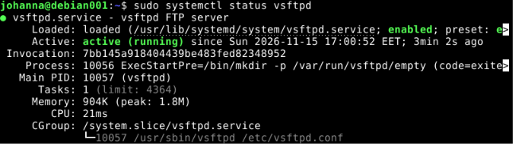

Lisäksi varmistin, että vsftpd kuuntelee FTP:n oletusporttia 21: ``ss -tulpn | grep :21``. 

Tuloste:

            tcp   LISTEN 0      32                 *:21               *:*

Tulosteen `LISTEN` perusteella vsftpd kuunteli saapuvia yhteyksiä. Merkintä `*:21` osoitti palvelun kuuntelevan FTP:n oletusporttia 21, joten palvelu oli valmis vastaanottamaan FTP-yhteyksiä.

Vsftpd-konfiguraatiotiedosto on etc-hakemistossa, polussa /etc/vsftpd.conf. Tein alkuperäisestä konfiguraatiotiedostosta kopion.
``sudo cp /etc/vsftpd.conf /etc/vsftpd.conf_orig``.

Muokkaan conf.-tiedostoa tekstieditori nanolla ``sudo nano /etc/vsftpd.conf``. 

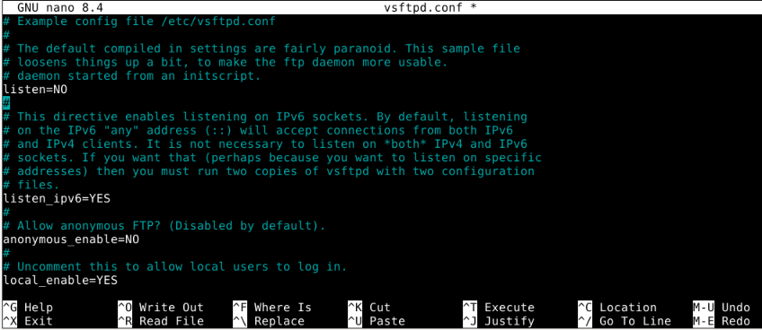

Muokkasin oletuskonfiguraatiota poistamalla tarpeettomat kommentoidut asetukset ja jättämällä vain tehtävän kannalta olennaiset asetukset. 

Konfiguraatiotiedoston sisältö laadittiin LinuxConfig.org:n Setup FTP Server on Linux using vsftpd ja DevelopNsolven How to Install vsftpd on Linux -artikkeleiden pohjalta. Asetuksia karsittiin tarpeisiin sopiviksi. Konfiguraatiotiedostossa määritettiin vsftpd-palvelimen perustoiminta ja turvallisuusasetukset.

            listen=YES
            listen_ipv6=NO

            anonymous_enable=NO
            local_enable=YES
            write_enable=YES

            chroot_local_user=YES
            allow_writeable_chroot=YES

            xferlog_enable=YES
            use_localtime=YES

            secure_chroot_dir=/var/run/vsftpd/empty
            pam_service_name=vsftpd

            ssl_enable=NO

**Konfiguraatiotiedoston sisältö:**

Palvelu kuuntelee IPv4-yhteyksiä eikä käytä IPv6:ta.

            listen=YES
            listen_ipv6=NO

Anonyymit kirjautumiset estettiin ja paikallisten käyttäjien kirjautuminen sallittiin.

            anonymous_enable=NO
            local_enable=YES

Käyttäjille sallittiin tiedostojen kirjoittaminen palvelimelle.

            write_enable=YES

Käyttäjät rajattiin omaan kotihakemistoonsa.

            chroot_local_user=YES
            allow_writeable_chroot=YES

Tiedostosiirtojen lokitus otettiin käyttöön ja lokit asetettiin käyttämään palvelimen paikallista aikaa.

            xferlog_enable=YES
            use_localtime=YES

Näitä asetuksia käytetään vsftpd:n turvalliseen toimintaan ja Linuxin käyttäjätunnistukseen.

            secure_chroot_dir=/var/run/vsftpd/empty
            pam_service_name=vsftpd

SSL/TLS-salausta ei otettu käyttöön (ssl_enable=NO), koska tavoitteena oli vain demonin asennuksen ja konfiguraationhallinnan automatisointi Ansiblella.

            ssl_enable=NO

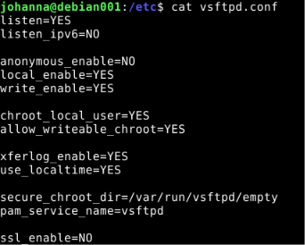

Kun konfiguraatiotiedostoa on muokattu, tulee demoni tulee käynnistää uudelleen komennolla ``sudo systemctl restart vsftpd``, jotta muutokset tulevat voimaan.

Testasin lopputuloksen localhostilla:
Vsftpd-palvelimen toimintaa testattiin FTP-asiakasohjelmalla. FTP-asiakas on ohjelma, joka muodostaa yhteyden FTP-palvelimeen ja mahdollistaa tiedostojen siirtämisen asiakkaan ja palvelimen välillä. FTP toimii asiakas-palvelin-mallilla, jossa asiakas lähettää palvelimelle pyyntöjä ja vastaanottaa vastauksia (Progress Software Corporation, 2022).

Yhteyden muodostuminen ja palvelimen lähettämä tervetuloviesti osoittivat, että vsftpd-palvelin oli käynnissä ja vastaanotti yhteyksiä.

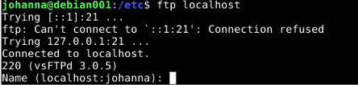

FTP-asiakasohjelma asennettiin vain vsftpd-palvelimen toiminnan testaamista varten. Ohjelmaa ei sisällytetä Ansible-rooliin, koska sen tehtävänä on automatisoida vsftpd-palvelimen asennus ja konfigurointi, eikä palvelun testaamiseen käytettyjen työkalujen asennusta.

Lähteet:
- DevelopNSolve Editorial Team. 2026. How to Install vsftpd on Linux.
- LinuxConfig.org. 2025. Setup FTP server on Linux.
- Progress Software Corporation. 2022. Overview of RFC 959.

### b) Automaatti - vsftpd asennuksen automatisointi Ansiblella

Olen käyttänyt tässä tehtävänosassa monia artikkeleita lähteenä, roolin yleiseen rakenteeseen Karvinen, T. 2026. Apache installed with Ansible ja Ansiblen omaa dokumentaatiota, osioita kuten "Roles", sekä copy ja service moduulit.

Halusin rakentaa mahdollisimman yksinkertaisen roolin.

Tavoitteeni oli:
1. asentaa vsftpd
2. kopioida konfiguraatiotiedosto
3. käynnistää ja ottaa palvelu käyttöön

Aloin rakentamaan roolia. Ensin loin Ansiblen hakemistoon "roles" roolin "vsftpd". Rooliin tulee hakemistot tasks, handlers ja files. Files hakemistoon kopioidaan vsftpd:n konfiguraatiotiedosto polusta ``/etc/vsftpd.conf`` jonka haluan siirtää kohdekoneelle (VPS).

Roolin rakenne:

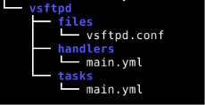

Konfiguraatiotiedoston rakenne (Tiedostoon lisätty "Managed file, changes will be overwritten":             

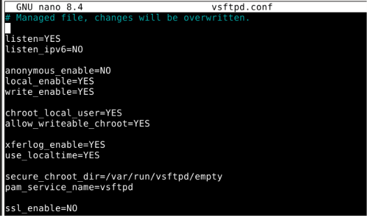

Rakensin roolin tasks hakemiston main.yml tiedostosta seuraavanlaisen:

         - apt:
             name: vsftpd
             state: present

         - copy:
             src: vsftpd.conf
             dest: /etc/vsftpd.conf
             owner: root
             group: root
             mode: "0644"
           notify: restart vsftpd

         - service:
             name: vsftpd
             state: started
             enabled: true

Eli rooli asentaa vsftpd-paketin, kopioi valmiin asetustiedoston kohdejärjestelmään ja varmistaa, että palvelu on käynnissä. Mikäli asetustiedosto muuttuu, Ansible käynnistää palvelun uudelleen handlerin avulla. Noudattaa yleistä mallia package -> file -> service.

1. **Paketin asennus**

Asentaa vsftpd-paketin kohdekoneelle. Mikäli paketti on jo asennettuna, Ansible ei tee muutoksia.

2. **Konfiguraatiotiedoston kopiointi**

Kopioi roolin files-hakemistossa olevan vsftpd.conf-tiedoston kohdekoneelle hakemistoon /etc/. Konfiguraatiotiedoston käyttöoikeuksiksi asetettiin 0644 (rw-r--r--). Näin tiedoston omistaja (root) voi lukea ja muokata tiedostoa, kun taas ryhmän jäsenet ja muut käyttäjät voivat lukea sitä.

notify: restart vsftpd käynnistää handlerin, jos tiedoston sisältö muuttuu. Handler käynnistää vsftpd-palvelun uudelleen, jotta uudet asetukset tulevat voimaan.

3. **Palvelun hallinta**

Viimeinen tehtävä varmistaa, että vsftpd-palvelu on käynnissä ja käynnistyy automaattisesti palvelimen uudelleenkäynnistyksen jälkeen.

**Handler**

Handlerin main.yml-tiedoston rakenne:

         - name: restart vsftpd
           service:
             name: vsftpd
             state: restarted

Seuraavaksi lisäsin roolin Ansible-hakemiston "site.yml"-tiedostoon.

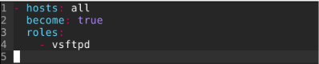

Ennen playbookin ajamista tarkistin syntaksin komennolla ``ansible-playbook site.yml --syntax-check``.

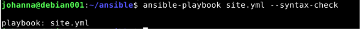

Ajoin playbookin komennolla ``ansible-playbook site.yml``.

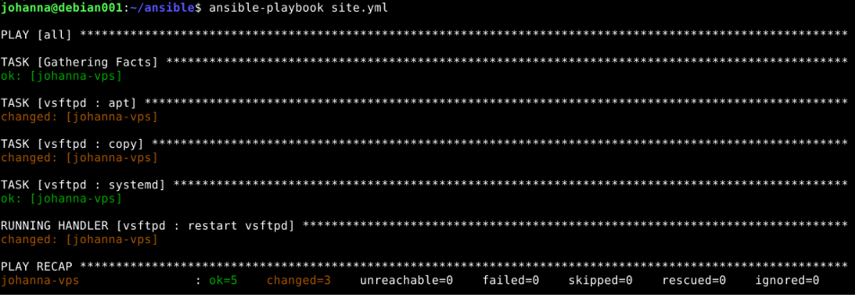

Otin SSH-yhteyden kohdekoneelle (VPS) ja tarkistin:

1. Onko paketti asennettu?
``dpkg -l | grep vsftpd``

2. Onko konfiguraatiotiedosto kopioitunut oikein ja sen miltä sen sisältö näyttää?
``ls -l /etc/vsftpd.conf``
``cat /etc/vsftpd.conf``

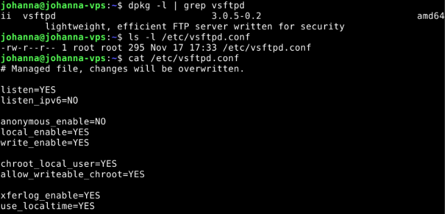

Tulosteiden perusteella näyttää hyvältä.

3. Onko palvelu käynnissä?
``sudo systemctl status vsftpd``

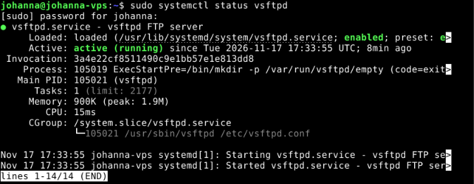

"Active running"-tila kertoo, että palvelu on käynnissä.

4. Kuunteleeko porttia 21 niinkuin kuuluu?
``ss -tulpn | grep :21``

Koska FTP-asiakasohjelmaa ei tosiaan asennettu VPS-palvelimelle osana Ansible-roolia, FTP-yhteyttä ei testattu VPS:llä asiakasohjelman (Client) avulla (``ftp localhost``). Palvelun toiminta varmistettiin tarkistamalla paketin asennus, konfiguraatiotiedoston olemassaolo, palvelun tila sekä oletusportin 21 kuuntelu.

Ajoin playbookin uudestaan, jotta voin osoittaa että enempää muutoksia kohdekoneella ei tapahdu.

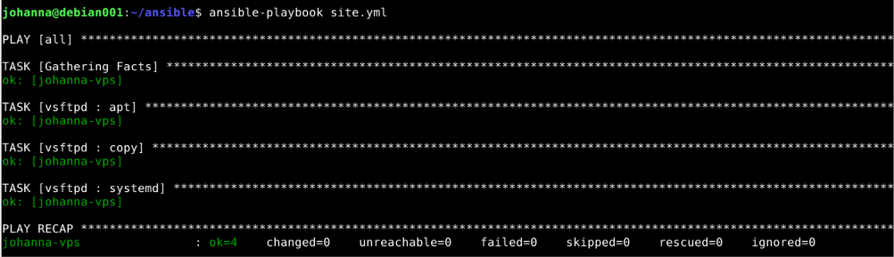

Lähteet:
- Ansible Community Documentation. 2026. Roles.
- Ansible Community Documentation. 2026. ansible.builtin.copy module – Copy files to remote locations.
- Ansible Community Documentation, 2026. ansible.builtin.service module – Manage services.
- Karvinen, T. 2026. Apache installed with Ansible - quick notes.

### c) Asetus - Muutetaan asetustiedostoa ohjauskoneella (Master)

Muutin ohjauskoneella asetuksen use_localtime=YES arvoon use_localtime=NO. Playbookin ajon jälkeen tarkistin VPS-palvelimella konfiguraatiotiedoston sisällön. Muutettu arvo näkyi tiedostossa, mikä osoitti Ansible-roolin päivittäneen asetuksen onnistuneesti.

1. **Muutetaan konfiguraatiotiedostoa**

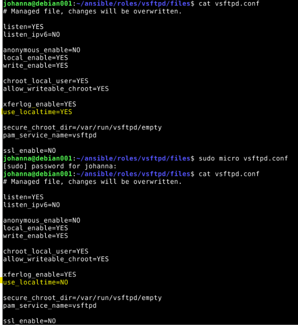

Tilanne kohdekoneella VPS:llä ennen muutoksia:

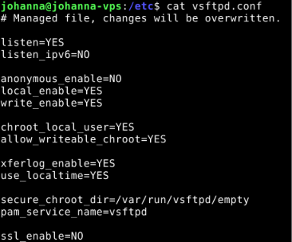

2. **Ajetaan playbook**
 
``ansible-playbook site.yml``

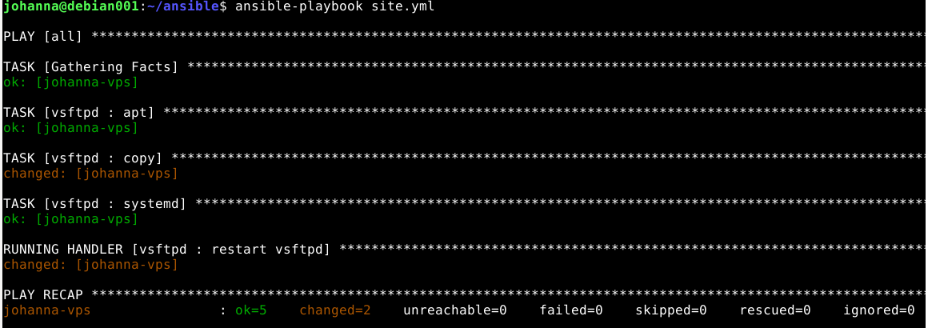

Konfiguraatiotiedosto muuttui -> notify aktivoitui -> handler suoritettiin -> palvelu käynnistettiin uudelleen asetuksen ottamiseksi käyttöön.

3. **Tarkistetaan onko tiedosto muuttunut VPS:llä**

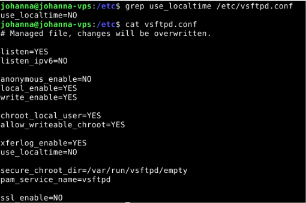

Tiedosto on muuttunut.

4. **Onko palvelu vielä käynnissä**

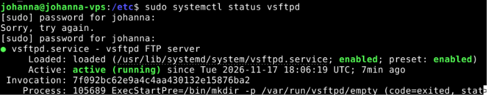

Palvelu oli käynnissä.

Ajan playbookin vielä kerran ohjauskoneella.

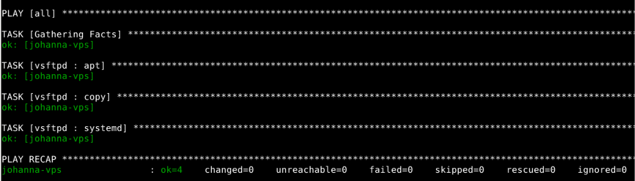

Ei muutoksia kohdekoneella.

### d) Paikka remonttiin - Riko jotain asetuksia

Päätin poistaa koko demonin kohdekoneelta ``sudo apt-get purge vsftpd``  ja ajaa playbookin uudestaan.

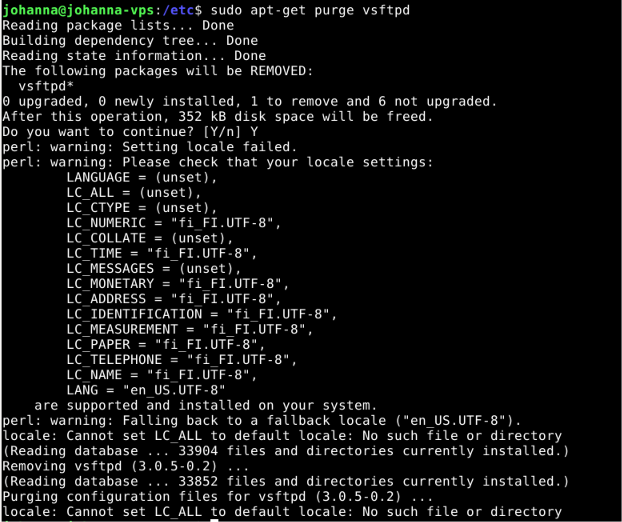

Palvelua ei enää löytynyt.

Siirryin takaisin ohjauskoneelle (Master) ja ajoin playbookin ``ansible-playbook site.yml``.

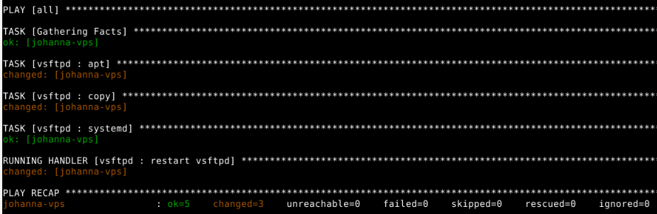

Kun playbook oli ajettu siirryin VPS:lle tarkistamaan onko palvelu asentunut ja käynnissä.

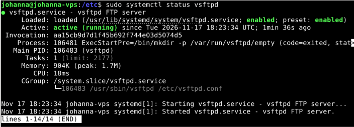

### e) Idempotenssi

Ajoin playbookin uudestaan ja totesin tilan idempotentiksi.

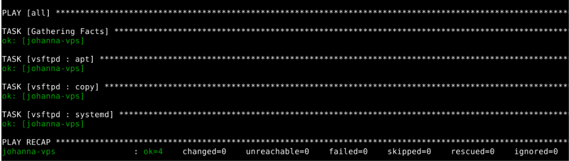

## Loppuyhteenveto

Tämän tehtävän aikana tuntui, että Ansiblen roolirakenne ja toiminnot jäivät paremmin mieleen. Pistin myös merkille, että komentorivikomennot ja Ansiblen toimintalogiikka alkaa tulemaan automaattisesti jostain takaraivosta. En tällä kertaa onnistunut saamaan aikaan yhtäkään erroria.

## Lähdeluettelo

- Ansible Community Documentation. 2026. ansible.builtin.copy module – Copy files to remote locations. Luettavissa: https://docs.ansible.com/projects/ansible/latest/collections/ansible/builtin/copy_module.html. Luettu: 15.11.2026.

- Ansible Community Documentation. 2026. ansible.builtin.service module – Manage services. Luettavissa: https://docs.ansible.com/projects/ansible/latest/collections/ansible/builtin/service_module.html. Luettu: 17.11.2026.

- Ansible Community Documentation. 2026. Roles. Luettavissa: https://docs.ansible.com/projects/ansible/latest/playbook_guide/playbooks_reuse_roles.html. Luettu: 17.11.2026.

- DevelopNSolve Editorial Team. 2026. How to Install vsftpd on Linux. Luettavissa: https://www.developnsolve.com/linux/how-to-install-vsftpd-in-linux. Luettu: 15.11.2026.

- Karvinen, T. 2024. PhD thesis. Configuration Management of Distributed Systems over Unreliable and Hostile Networks. University of Westminster. Luettavissa: https://doi.org/10.34737/w7vvz. Luettu: 15.11.2026.

- Karvinen, T. 2026. Apache installed with Ansible - quick notes. Luettavissa: https://terokarvinen.com/apache-ansible/. Luettu: 15.11.2026.

- LinuxConfig.org. 2025. Setup FTP server on Linux. Luettavissa: https://linuxconfig.org/setup-ftp-server-on-linux. Luettu: 15.11.2026.

- Progress Software Corporation. 2022. Overview of RFC 959. Luettavissa: https://docs.ipswitch.com/WS_FTP_Server2022/Help/Server/46300.htm. Luettu: 15.11.2026.

## Tekoälyn käyttö

Tämän tehtävän tekemisessä on käytetty Microsoft 365 Copilot GPT-5 chat -kielimallia. Kielimallia on käytetty lähteiden etsimiseen, sekä lähdeluettelon aakkostamiseen.

Vastaan itse raportin sisällöstä, tehtävien suorittamisesta, komentojen testaamisesta ja tulosten dokumentoinnista.
