# H5 Gitar Hero

## x) Lue ja tiivistä

### What is Git?
- Git eroaa monista vanhemmista versionhallintajärjestelmistä siinä, että se tallentaa projektin tilan hetkikuvina (snapshots) eikä pelkkinä tiedostomuutoksina.
- Jokainen commit on ikään kuin valokuva projektista tietyllä hetkellä. Muuttumattomia tiedostoja ei tallenneta uudelleen, vaan Git viittaa aiemmin tallennettuihin versioihin.
- Lähes kaikki Gitin toiminnot voidaan tehdä paikallisesti ilman verkkoyhteyttä, koska koko projektihistoria kopioituu omalle koneelle.
- Git varmistaa tiedon eheyden SHA-1-tiivisteiden avulla. Jos tiedoston sisältö muuttuu, myös sen tunniste muuttuu.
- Gitissä tiedosto voi olla kolmessa tilassa, modified (muokattu), staged (valittu seuraavaan committiin) ja committed (tallennettu versionhallintaan).
- Muokataan tiedostoa -> lisätään muutokset staging-alueelle -> tehdään commit.
- Oma huomio: Gitin toimintatapa muistuttaa enemmän tiedostojärjestelmää kuin pelkkää muutosten seurantaa.

Lähde: Chacon and Straub. 2014. Pro Git, 2edGit. 1.3 Getting Started - What is Git?

### git add --all && git commit; git pull && git push

``git add --all`` = Lisää kaikki uudet, muokatut ja poistetut tiedostot staging-alueelle

``&&`` = Suorittaa seuraavan komennon, jos edellinen on suoritettu onnistuneesti (LinuxVox.com. 2026.)

`git commit` = Tallentaa staging-alueella olevat muutokset paikalliseen Git-historiaan uutena committina

`git pull &&` = Hakee palvelimelta uusimmat muutokset ja yhdistää ne paikalliseen kopioon

`git push` = Lähettää paikalliset commitit etävarastoon (esim. GitHubiin)

Oma huomio: Komennossa git commit tarvitsee commit-viestin ennen kuin tallennus versionhallintaan voidaan suorittaa loppuun.
esim. `git add --all && git commit -m "Commit message" && git pull && git push` (Geeks for Geeks. 2025.)

Lähteet:
- Geeks for Geeks. 2025. Git Cheat Sheet.
- Git. Learn: Git Cheat Sheet.
- LinuxVox.com. 2026. Understanding the Difference between && and || in Linux.

## Johdanto

Harjoituksessa käytettiin Linux Debian 13-virtuaalikonetta Oracle VirtualBoxissa. Versionhallintaan käytettiin Gitiä ja etävarastona GitHubia. Tehtäväkohdassa e, Ansible playbook ajettiin VPS:lle, jossa Debian 13 käyttöjärjestelmä.

Debian 13 virtuaalikoneeseeni oli jo aikaisemmin asennettu git ja julkinen pääsyavain viety GitHub-tililleni yhteyden muodostamista varten.

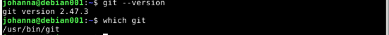

### a) Online - Tee uusi varasto GitHubiin

Aloitin luomalla repositoryn GitHubiin, jonka nimessä ja kuvauksessa on tehtävänannon mukainen "sunshine".

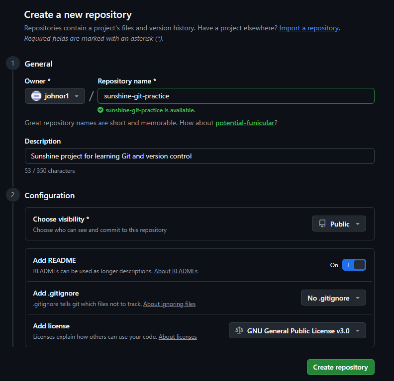

Repositoryssa on kolme tiedosto: Readme, license ja lisäämäni markdown-tiedosto, jossa rivi tekstiä.

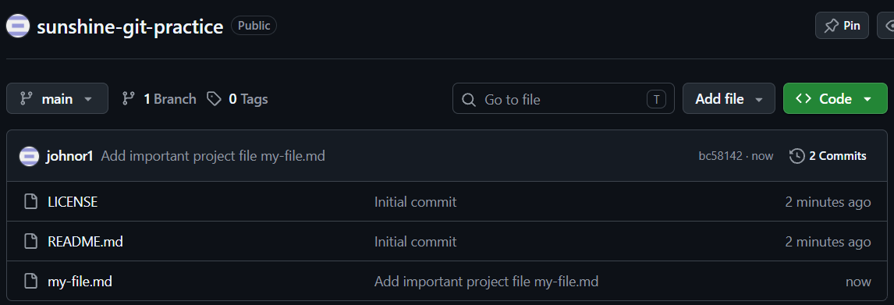

### b) Dolly - Kloonaa paikalliselle koneelle ja tee muutoksia etävarastoon

Aloitin menemällä paikallisella koneella hakemistoon johon haluan kloonata repositoryn. Halusin kloonata repon kotihakemistooni /home/johanna. Koska olen jo aikasemmin lisännyt virtuaalikoneeni julkisen avaimen GitHub-tiliini, käytän SSH:ta repon kloonaamiseen.

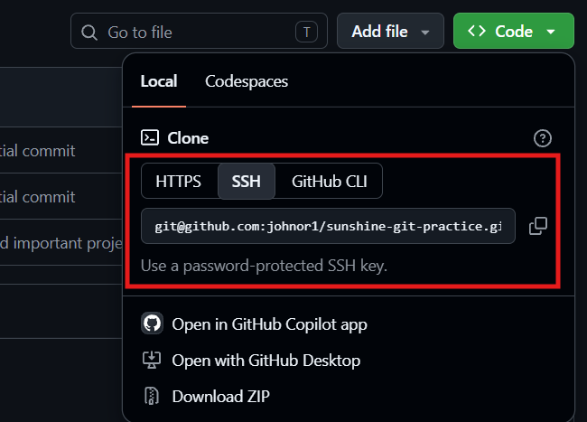

Komennolla `git clone git@github.com:johnor1/sunshine-git-practice.git` kloonaan repon virtuaalikoneelleni.

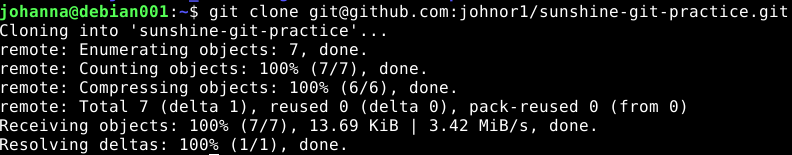

Repository onnistuneesti kloonattuna paikalliselle vm:lle.

Repositoryssa on tällä hetkellä kolme tiedostoa ja aion lisätä virtuaalikoneellani sinne yhden tekstitiedoston lisää.

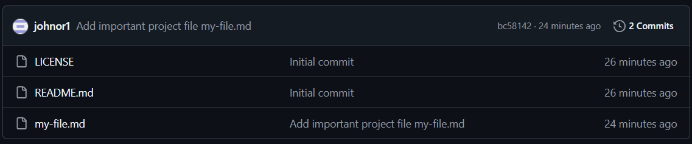

Loin kloonattuun hakemistoon uuden tekstitiedoston `sudo micro myfile.txt`.

Uuden myfile-nimisen tiedoston sisältö, sisällön voi nähdä komentorivillä komennolla `cat myfile.txt`:

Tehdään kaikki yhdellä komennolla komentorivillä, eli add, commit (ja commit message), pull ja push.

`git add --all && git commit -m "Add textfile" && git pull && git push`

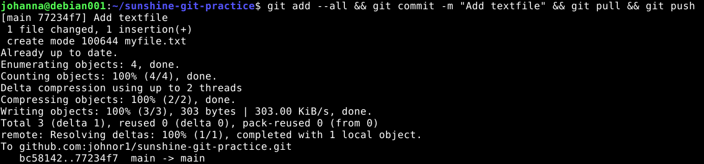

Push virtuaalikoneelta onnistui ja muutokset, eli uusi lisätty tiedosto näkyy GitHubissa selaimella.

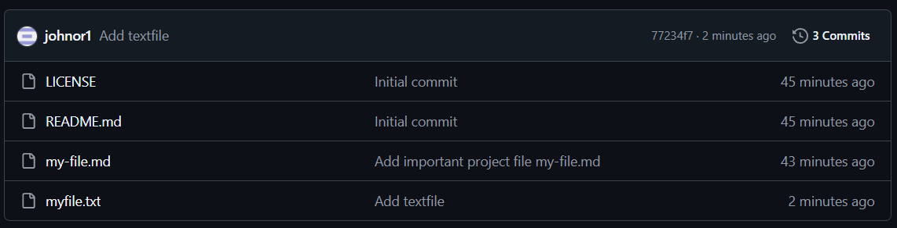

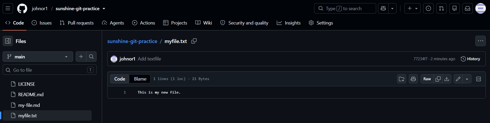

Lähde:
- Geeks for Geeks. 2026. Cloning a Remote Git Repository.
- Geeks for Geeks. 2025. Git Cheat Sheet.

### c) Doh! - Virheellisen muutoksen poistaminen git reset --hard -komennolla

1. Muokkasin tiedostoa.
2. Tarkistin komennolla `git status`, että Git tunnisti tiedoston muuttuneeksi (modified).

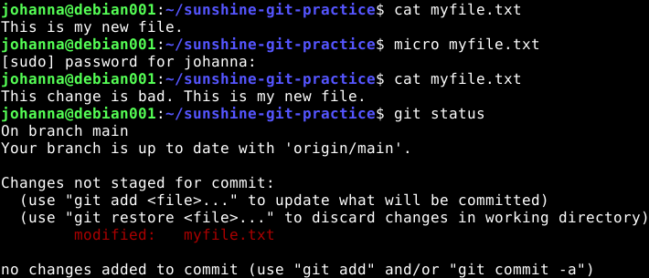

3. Ajoin komennon `git reset --hard` joka palautti työhakemiston viimeisimmän commitin mukaiseen tilaan.
4. Tarkistin uudelleen `git status`-komennolla, että muutokset oli poistettu.  

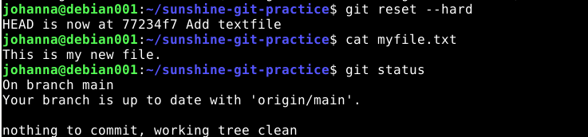

Komento `git reset --hard` palauttaa projektin tiedostot valittuun commitiin ja poistaa sekä staging-alueella että työhakemistossa olevat tallentamattomat muutokset. Tässä harjoituksessa komentoa käytettiin poistamaan tarkoituksella tehty virheellinen muutos (Geeks for Geeks, 2026).

Lähde:
- Geeks for Geeks. 2026. Git Reset.

### d) Tukki - Git-lokin tarkastelu ja käyttäjätietojen varmistaminen
<!--d) Tukki. Tarkastele ja selitä varastosi lokia. Näytä myös, mitä muutoksia tiedostoihin on tehty. Tarkista, että nimesi ja sähköpostiosoitteesi näkyy haluamallasi tavalla ja korjaa tarvittaessa. -->

Aloitin tarkistamalla käyttäjänimeni ja sähköpostiosoitteeni komennoilla `git config --global user.name` ja `git config --global user.email`.

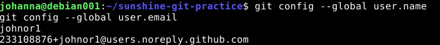

Sähköpostiosoitteena oli käytössä Githubin noreply-sähköpostiosoite niinkuin haluankin.

Komennolla `git log` lokin tarkastelua, lokissa näkyy kolme committia..

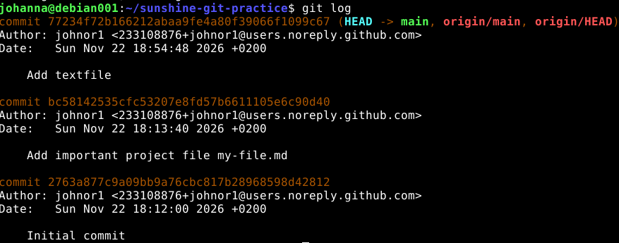

Tarkastelin historiaa komennolla `git log --patch`, joka näyttää sekä commitit että niissä tehdyt muutokset tiedostoihin.

Lokissa näkyi kolme commitia.

1. Initial commit, jossa GitHub loi varaston perustiedostot.
2. Add important project file my-file.md, jossa varastoon lisättiin tiedosto my-file.md.
2. Add textfile, jossa varastoon lisättiin tiedosto myfile.txt.

Commitien yhteydessä näkyvä diff kertoi tarkasti, mitä muutoksia tiedostoihin oli tehty. Diffistä näki, että commitissa luotiin uusi tiedosto myfile.txt. Tiedostoa ei ollut aiemmin olemassa (/dev/null) ja siihen lisättiin yksi rivi tekstiä: This is my new file.. 

Plusmerkillä alkavat rivit ovat lisättyä sisältöä.

Lokista voitiin myös nähdä commitien tekijä (johnor1) sekä GitHubin käyttämä sähköpostiosoite (233108876+johnor1@users.noreply.github.com).

            commit 77234f72b166212abaa9fe4a80f39066f1099c67 (HEAD -> main, origin/main, origin/HEAD)
            Author: johnor1 <233108876+johnor1@users.noreply.github.com>
            Date:   Sun Nov 22 18:54:48 2026 +0200

                Add textfile

            diff --git a/myfile.txt b/myfile.txt
            new file mode 100644
            index 0000000..50840be
            --- /dev/null
            +++ b/myfile.txt
            @@ -0,0 +1 @@
            +This is my new file.

            commit bc58142535cfc53207e8fd57b6611105e6c90d40
            Author: johnor1 <233108876+johnor1@users.noreply.github.com>
            Date:   Sun Nov 22 18:13:40 2026 +0200

                Add important project file my-file.md

            diff --git a/my-file.md b/my-file.md
            new file mode 100644
            index 0000000..7cf39d1
            --- /dev/null
            +++ b/my-file.md
            @@ -0,0 +1 @@
            +This is important file for this project.

            commit 2763a877c9a09bb9a76cbc817b28968598d42812
            Author: johnor1 <233108876+johnor1@users.noreply.github.com>
            Date:   Sun Nov 22 18:12:00 2026 +0200

                Initial commit

            diff --git a/LICENSE b/LICENSE
            new file mode 100644
            index 0000000..f288702
            --- /dev/null
            +++ b/LICENSE
            @@ -0,0 +1,674 @@

### e) Gitanbile - Ansible-kansion versionhallinta

Siirryin Ansible-hakemistoon `cd /home/johanna/ansible`.

Ajoin komennon `git init`, jolla Ansible-hakemistosta luotiin uusi Git-versionhallintavarasto. Hakemiston tiedostoja voitiin tämän jälkeen seurata Gitillä ja tallentaa committeina.

Päätin tätä tehtävää varten luoda roolin "tree", jolla asennetaan paketti Ansiblella VPS:lle.

Roolin rakenne:

        ├── tree
        │   └── tasks
        │       └── main.yml

Tasks main.yml -tiedoston rakenne:

         - apt:
             name: tree
             state: present

Lisäsin roolin "tree" site.yml-tiedostoon.

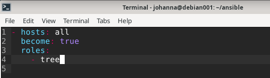

Ajan playbookin komennolla `ansible-playbook site.yml`.

Playbook ajettiin onnistuneesti.

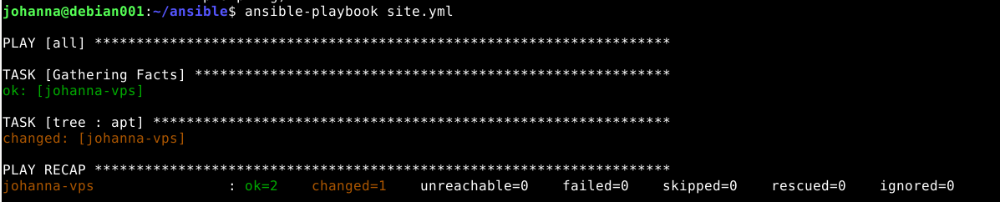

Otin yhteyden VPS:lle ja tarkistin onko tree asentunut oikein. Komennolla `tree --version` näkee ohjelman versionumeron.

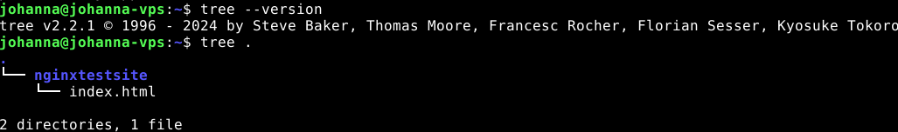

Tallensin muutokset versionhallintaan komennolla `git add .` ja sen jälkeen komennolla `git commit -m "Add tree role"` tein commitin ja annoin commitmessagen.

Commitin jälkeen Git ilmoitti luoneensa ensimmäisen commitin (root-commit) ja tallentaneensa projektin tiedostot versionhallintaan.

Myöhemmin tein vielä muutoksen Tree-rooliin ja tallensin sen uudella commitilla > `git add .` ja `git commit -m "Change tree role"`.

Lokista näkyi onnistuneesti luodut commitit (`git log --oneline`.

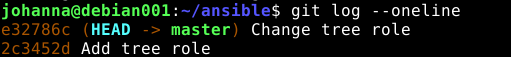

Lokia komennolla `git log --patch`.

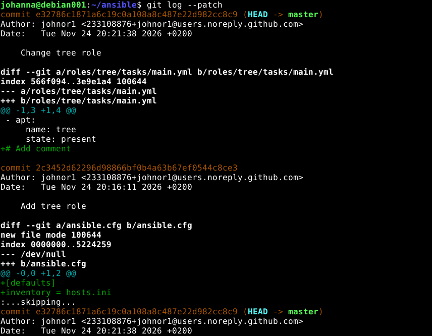

### f) Projektiparin hankinta

Projektipari on hankittu.

## Lähdeluettelo

- Chacon, S. & Straub, B. 2014. Pro Git, 2nd Edition: 1.3 Getting Started - What is Git? Luettavissa: https://git-scm.com/book/en/v2/Getting-Started-What-is-Git%3F. Luettu 22.11.2026.

- GeeksforGeeks. 2025. Git Cheat Sheet. Luettavissa: https://www.geeksforgeeks.org/git/git-cheat-sheet/. Luettu 22.11.2026.

- GeeksforGeeks. 2026. Cloning a Remote Git Repository. Luettavissa: https://www.geeksforgeeks.org/git/how-to-git-clone-a-remote-repository/. Luettu 22.11.2026.

- GeeksforGeeks. 2026. Git Reset. Luettavissa: https://www.geeksforgeeks.org/git/how-to-reset-to-head-in-git/. Luettu 24.11.2026.

- Git. Git Cheat Sheet. Luettavissa: https://git-scm.com/cheat-sheet. Luettu 22.11.2026.

- LinuxVox. 2026. Understanding the Difference Between && and || in Linux. Luettavissa: https://linuxvox.com/blog/difference-between-and-in-linux/. Luettu 22.11.2026.

## Tekoälyn käyttö

Tämän tehtävän tekemisessä on käytetty Microsoft 365 Copilot GPT-5 chat -kielimallia. Kielimallia on käytetty lähteiden etsimiseen sekä lähdeluettelon aakkostamiseen.

Vastaan itse raportin sisällöstä, tehtävien suorittamisesta, komentojen testaamisesta ja tulosten dokumentoinnista.
